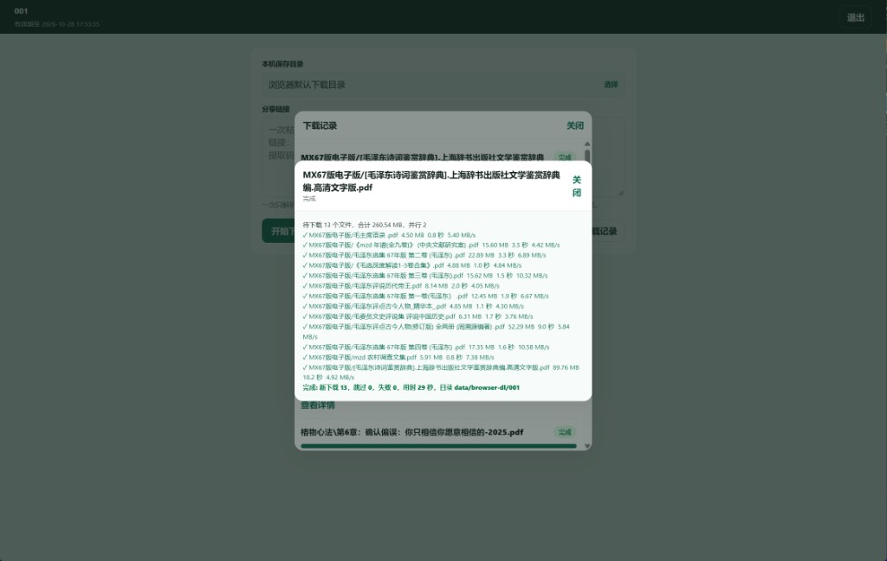
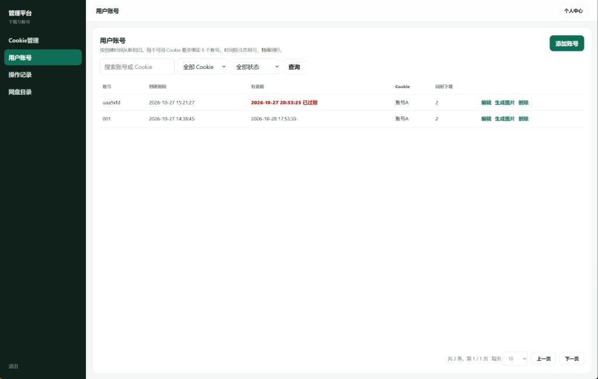

# pan_drive

夸克网盘 WebDAV 服务，并附带分享转存下载门户。

基于 [chenqimiao/quarkdrive-webdav](https://github.com/chenqimiao/quarkdrive-webdav)（MIT）二次开发。  
**非夸克官方项目**；Cookie / 账号风险自负。

## 功能

- **WebDAV**：挂载夸克网盘，适配 Infuse、nPlayer、NAS 等客户端
- **分享门户**（`/`）：用户登录 → 粘贴分享链接 → 选择文件转存 → 保存到本机
  - 浏览器本机保存模式：只转存到网盘，由浏览器拉取到本地，不写服务器下载目录
- **管理端**（`/admin`）：用户、Cookie 池、下载额度、门户设置、登录信息图片等
- Docker / 源码编译部署

## 界面预览

### 用户下载页

登录后粘贴分享链接即可转存下载；可选择本机目录，或使用浏览器默认下载目录。任务详情里可查看每个文件的进度与结果。



### 管理端 · 用户账号

在管理平台维护用户、绑定 Cookie、设置有效期与并行数；支持「生成图片」导出登录信息卡片。



## 依赖

- Rust 工具链（源码编译）或 Docker
- **MySQL 8**（下载任务等元数据）
- 有效的夸克网盘 Cookie（`quark.cookie` 或管理端 Cookie 池）

## 快速开始

### 1. 配置

本地直接跑二进制 / `cargo run`：

```bash
cp config.json.example config.json
# 编辑 database 账号密码；默认连 127.0.0.1:3306
```

Docker Compose（容器内连同 compose 里的 MySQL）：

```bash
cp config.docker.json.example config.json
# 默认 root / change_me，请先改密码再启动
```

`config.json`、`portal.json`、`quark.cookie`、`data/` **不要提交到 Git**（已在 `.gitignore`）。

### 2. 本地运行

```bash
# Cookie：环境变量或文件二选一
export QUARK_COOKIE='你的cookie'
# 或写入 quark.cookie

cargo run --release
```

- 用户页：<http://127.0.0.1:8080/>
- 管理页：<http://127.0.0.1:8080/admin>（首次访问设置管理员密码）
- WebDAV：同一端口（可用 `-U` / `-W` 或环境变量设置认证）

### 3. Docker Compose

```bash
cp config.docker.json.example config.json
# 修改 MySQL 密码：同时改 config.json 与 docker-compose.yml 里 MYSQL_ROOT_PASSWORD
docker compose up -d --build
```

默认映射 `8080:8080`。若前面有反代、需要挂外部网络，可参考 `docker-compose.prod.example.yml`。

## 配置说明

| 项 | 说明 |
|----|------|
| `config.json` | 监听地址、端口、`data_dir`、MySQL |
| `portal.json` | 管理员、用户、Cookie 池、门户设置（运行后自动生成） |
| `quark.cookie` | 主 Cookie 文件；也可在管理端维护多组 Cookie |
| 用户本机目录 | 本机绝对路径，或浏览器保存标记 `__browser__` |

常用环境变量：`HOST`、`PORT`、`QUARK_COOKIE`、`QUARK_COOKIE_FILE`、`WEBDAV_AUTH_USER`、`WEBDAV_AUTH_PASSWORD` 等。

## 安全提示

- 切勿把 Cookie、`portal.json`、含真实密码的 `config.json` 推到公开仓库
- 生产环境建议 HTTPS；普通 HTTP 下 Chrome 无法使用「自选文件夹」，只能走浏览器默认下载
- Cookie 等同账号权限，注意泄露与封禁风险

## 命令行（WebDAV）

```bash
quarkdrive-webdav --quark-cookie '你的cookie' -U '用户名' -W '密码' -p 8080
```

## 免责声明

本项目仅供学习与个人使用。使用者应遵守当地法律法规与夸克服务条款；因使用本项目导致的账号风险、数据损失等，作者不承担责任。

## License

[MIT](./LICENSE)

上游版权归原作者所有；本仓库修改部分同样以 MIT 许可发布。
